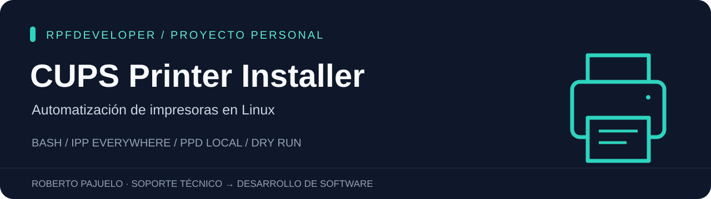

<p align="center">
  
</p>

<p align="center">
  <strong>Bash · Linux · CUPS · Python unittest</strong><br>
  De un problema del soporte técnico a una herramienta de línea de comandos.
</p>

# CUPS Printer Installer

[](https://github.com/Rpfdeveloper/Scripttoinstallprinters/actions/workflows/checks.yml)

Herramienta para crear y actualizar una cola de impresión local en Linux con CUPS. Admite **IPP Everywhere** y archivos **PPD locales**, con validación previa y un modo de simulación que permite revisar el comando sin contactar con CUPS.

Proyecto personal de **Roberto Pajuelo**, nacido de mi experiencia en diagnóstico y reparación de impresoras y equipos multifunción. El prototipo original se centraba en menús por fabricante; esta versión separa la configuración de la cola de la selección del controlador.

**English:** A Bash CLI for configuring local Linux CUPS queues, using IPP Everywhere or a trusted local PPD. Includes dry-run mode and automated tests with mocked CUPS commands. Hardware compatibility has not been certified.

[Guía técnica para revisar el código (English)](docs/ENGINEERING.md) · [Validación con hardware](docs/VALIDATION.md) · [Historial de cambios](CHANGELOG.md)

## Qué demuestra

| Problema | Decisión de implementación |
| --- | --- |
| Evitar asignar un controlador a un modelo equivocado | IPP Everywhere o PPD seleccionado explícitamente; sin catálogo de equivalencias inventadas. |
| Revisar antes de modificar el sistema | `--dry-run` valida las entradas y muestra el comando. |
| Evitar cambios accidentales en colas existentes | Se requiere `--update` para una cola ya creada, incluso si cambia la capitalización del nombre. |
| Manejar espacios y entradas del usuario | Comando construido con un array Bash; sin `eval`. |
| Detectar errores de CUPS | Comprobación explícita del estado del servicio, inventario de colas y verificación posterior. |
| Mantener la protección en sistemas con otro idioma | `LC_ALL=C` y `LC_MESSAGES=C` para interpretar las respuestas de CUPS. |
| Probar sin una impresora | 28 pruebas automatizadas con comandos CUPS simulados. |

## Requisitos

- Linux y Bash 4 o posterior.
- Para aplicar cambios: CUPS en el equipo local, comandos `lpadmin` y `lpstat`, y permisos de administración de CUPS.
- Una impresora accesible con una URI conocida y compatible con la modalidad elegida.
- Para PPD: archivo local, descomprimido y obtenido de una fuente de confianza. Algunos modelos requieren filtros adicionales del fabricante.
- Para pruebas: Python 3. No requieren CUPS, privilegios ni una impresora.

El modo `--dry-run` no requiere CUPS instalado ni permisos de administración.

## Empezar en dos minutos

```bash
git clone https://github.com/Rpfdeveloper/Scripttoinstallprinters.git
cd Scripttoinstallprinters
bash install-printer.sh --help
```

### 1. Revisar una configuración IPP Everywhere

Sustituye la URI de ejemplo por la que publique tu impresora. La ruta `/ipp/print` no es universal.

```bash
bash install-printer.sh \
  --name Oficina \
  --uri ipp://printer.local/ipp/print \
  --driverless \
  --dry-run
```

Salida de ejemplo del modo de simulación:

```text
Dry run: local CUPS will not be contacted. Queue state and device compatibility are not checked.
Command: lpadmin -h localhost -p Oficina -E -v ipp://printer.local/ipp/print -m everywhere -o printer-is-shared=false
```

### 2. Aplicar la configuración

Después de revisar los datos, elimina `--dry-run`. Ejecuta como usuario autorizado en CUPS; utiliza `sudo` si tu configuración local lo requiere:

```bash
sudo bash install-printer.sh \
  --name Oficina \
  --uri ipp://printer.local/ipp/print \
  --driverless \
  --description "Impresora de oficina" \
  --location "Planta 1"
```

### Usar un PPD local

La dirección `192.0.2.10` es un ejemplo y debe sustituirse. Este comando no demuestra compatibilidad con un modelo concreto:

```bash
bash install-printer.sh \
  --name Taller \
  --uri socket://192.0.2.10:9100 \
  --ppd "/ruta/al/controlador verificado.ppd" \
  --dry-run
```

Repite sin `--dry-run`, con los permisos adecuados, para aplicar. CUPS considera obsoletos los PPD y los controladores tradicionales; utiliza IPP Everywhere cuando el equipo lo admita. El instalador no descarga paquetes ni instala los filtros que pueda necesitar un PPD.

## Opciones

| Opción | Uso |
| --- | --- |
| `--name NOMBRE` | Nombre de cola: 1–127 letras, números, guiones o guiones bajos; comienza por letra o número. |
| `--uri URI` | URI `ipp://`, `ipps://`, `socket://` o `lpd://`; sin credenciales, parámetros ni fragmentos. Se comprueba el formato básico; CUPS verifica la conexión al aplicar. |
| `--driverless` | Configuración IPP Everywhere, solo con IPP o IPPS. |
| `--ppd ARCHIVO` | PPD local legible y descomprimido; excluye `--driverless`. |
| `--description TEXTO` | Descripción legible de la impresora. |
| `--location TEXTO` | Ubicación. |
| `--dry-run` | Mostrar el comando sin contactar con CUPS. |
| `--update` | Permitir modificar una cola existente. No crea una copia de seguridad. |
| `--help` / `--version` | Ayuda / versión. |

La operación actúa sobre **CUPS local**, habilita la cola y la deja sin compartir. No cambia la impresora predeterminada ni envía trabajos de prueba. `--update` también aplica estas opciones a la cola existente.

## Pruebas y alcance de la validación

```bash
bash -n install-printer.sh InstaladorDriberLinux.sh
python3 -m unittest discover -s tests -v
```

Las 28 pruebas comprueban argumentos, selección del controlador, URI, rutas con espacios, tratamiento literal de los textos, simulación, colas existentes y errores del servicio. Incluyen regresiones para CUPS detenido con código de salida cero, respuestas de estado no reconocidas y configuración de idioma heredada. Los comandos `lpadmin` y `lpstat` se sustituyen por dobles de prueba: **no se configura una impresora real**.

Validación realizada: sintaxis Bash y suite automatizada en Linux. La instalación con CUPS y un dispositivo físico queda pendiente de una prueba de integración. No se afirma compatibilidad certificada con Sharp, Toshiba o Konica Minolta.

### Códigos de salida

| Código | Resultado |
| --- | --- |
| `0` | Ayuda, simulación válida o configuración aceptada y cola comprobada. |
| `2` | Argumentos o archivo PPD no válidos. |
| `3` | Comandos CUPS, servicio o consulta de colas no disponibles. |
| `4` | Cola existente sin autorización explícita de actualización. |
| `5` | Configuración rechazada o verificación posterior fallida. Puede quedar una configuración parcial. |

## Estructura

- [`install-printer.sh`](install-printer.sh): CLI y validación.
- [`InstaladorDriberLinux.sh`](InstaladorDriberLinux.sh): entrada de compatibilidad con el nombre original; acepta las nuevas opciones.
- [`tests/test_installer.py`](tests/test_installer.py): pruebas sin impresora.
- [`docs/ENGINEERING.md`](docs/ENGINEERING.md): guía de lectura, decisiones técnicas y regresiones, en inglés.
- [`docs/VALIDATION.md`](docs/VALIDATION.md): procedimiento de comprobación con hardware.
- [`CHANGELOG.md`](CHANGELOG.md): evolución del proyecto.

## Comprobar una instalación real

Consulta [`docs/VALIDATION.md`](docs/VALIDATION.md) antes de probar con un equipo. El proyecto no elimina colas ni implementa rollback automático; revisa CUPS tras un fallo antes de repetir la operación.

## Autoría y referencias

Proyecto personal: [Roberto Pajuelo · Rpfdeveloper](https://github.com/Rpfdeveloper). Desarrollado con asistencia de IA; las decisiones, cambios y pruebas pueden revisarse en el historial del repositorio.

- [Documentación oficial de `lpadmin`, OpenPrinting CUPS](https://github.com/OpenPrinting/cups/blob/master/man/lpadmin.8): opciones de configuración, IPP Everywhere y obsolescencia de PPD.
- [Documentación oficial de `lpstat`, OpenPrinting CUPS](https://github.com/OpenPrinting/cups/blob/master/man/lpstat.1): consulta del servicio y las colas.

Los controladores de fabricantes no se incluyen ni redistribuyen en este repositorio.
