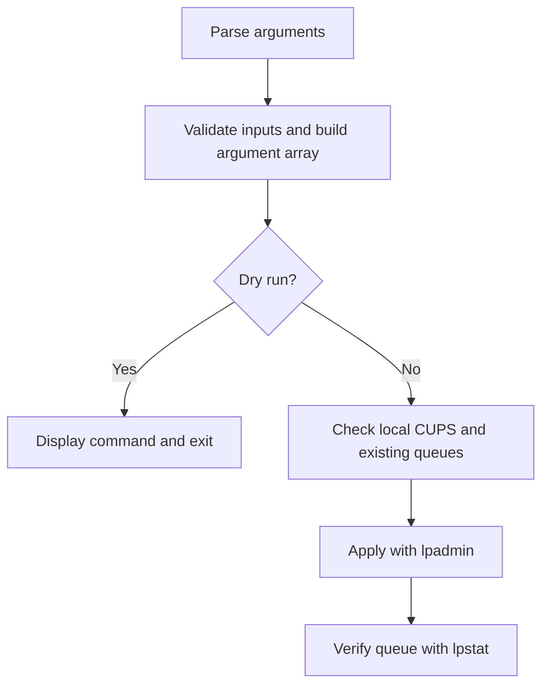

# Technical review guide

This personal project turns experience with printing systems into a small Linux automation tool. Roberto Pajuelo's original prototype and subsequent changes are available in the Git history. Recent development used AI assistance, as disclosed in the [README](../README.md).

## Run it without a printer

From the repository root:

```bash
bash -n install-printer.sh InstaladorDriberLinux.sh
python3 -m unittest discover -s tests -v
bash install-printer.sh --name Demo --uri ipp://printer.local/ipp/print --driverless --dry-run
```

The tests replace CUPS commands with temporary executables. The dry run validates local inputs and displays the command; neither operation configures a real printer.

## Follow the execution



| Decision | Where to look | Observable behavior |
| --- | --- | --- |
| Keep user text separate from shell code | Bash arrays in [install-printer.sh](../install-printer.sh) | Spaces and shell syntax stay literal arguments; no `eval`. |
| Require explicit updates | Queue inventory and `--update` check | Existing queue names are compared without case sensitivity; unauthorized updates stop with exit code 4. |
| Confirm CUPS status before making changes | Scheduler check | Both command failure and a response other than the expected running status stop with exit code 3. |
| Keep previews independent of CUPS | Early return for `--dry-run` | Tests record both `lpadmin` and `lpstat` calls and confirm neither is invoked. |
| Report incomplete operations honestly | Post-install check | A rejected configuration or failed verification returns exit code 5; automatic rollback is not implemented. |

## What the 1.0.1 regressions catch

`lpstat -r` can return exit code zero when the scheduler is stopped. Checking only the exit code allowed the old implementation to continue to queue inspection. The installer now requires the running status explicitly before proceeding.

CUPS 2.4 can also select translated messages using an inherited `LC_MESSAGES` value before `LC_ALL`. Since the installer reads CUPS status and queue output, it now exports both as `C`. This preserves the existing-queue check when the caller uses another language.

The three new regression tests cover a stopped scheduler with exit code zero, empty or unrecognized status responses, and an inherited message locale. They failed against version 1.0.0 before the correction. All 28 tests pass against version 1.0.1 in the local Linux test environment; the [Actions workflow](https://github.com/Rpfdeveloper/Scripttoinstallprinters/actions/workflows/checks.yml) records hosted results.

Primary implementation references: OpenPrinting CUPS 2.4.20 [`systemv/lpstat.c`](https://github.com/OpenPrinting/cups/blob/v2.4.20/systemv/lpstat.c) (`main`, `show_scheduler`) and [`cups/language.c`](https://github.com/OpenPrinting/cups/blob/v2.4.20/cups/language.c) (`cupsLangGet`).

## Validation boundary

These checks establish CLI behavior with simulated CUPS responses. They do not establish hardware compatibility, driver quality or successful physical printing. Use the [hardware validation procedure](VALIDATION.md) with a separate test queue to collect that evidence. The installer does not download vendor drivers, set the default printer or send test jobs.
